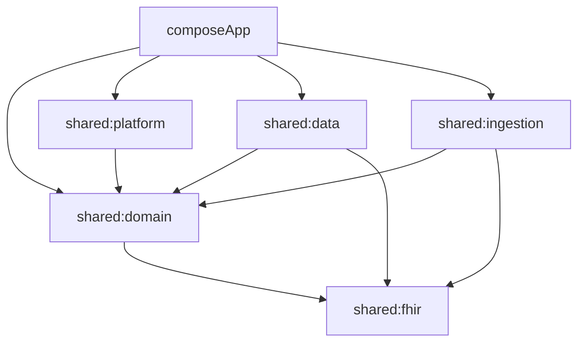

# 01. Structura proiectului

Stack-ul este stabilit în [ADR-0012](../adr/0012-stack-tehnic-android.md): **Kotlin Multiplatform**, **Compose Multiplatform**, **Room KMP**, **Koin**. Prima versiune livrează doar Android.

## 1. Ținte (targets)

| Modul | Ținte | De ce |
|---|---|---|
| Modulele `shared:*` | `androidTarget()` + `jvm()` | `jvm()` permite rularea testelor din `commonTest` pe calculator și în CI, fără emulator. Tot acolo rulează validatorul oficial HL7 (doc. 09) |
| `composeApp` | `androidTarget()` | Interfața Android |
| iOS (`iosArm64`, `iosSimulatorArm64`) | **Nu acum** | Se adaugă la începutul versiunii iOS. Până atunci, codul din `commonMain` nu are voie să folosească API-uri Java/Android, ca mutarea să fie simplă |

## 2. Modulele Gradle

```
patient/
├── settings.gradle.kts
├── gradle/libs.versions.toml          ← singurul loc cu versiuni
├── composeApp/                        ← interfața + punctul de intrare Android
├── shared/
│   ├── fhir/                          ← modelul FHIR R4, serializare, validare
│   ├── domain/                        ← cazuri de utilizare, reguli, porturi (interfețe)
│   ├── ingestion/                     ← pipeline-ul de citire a documentelor (logica comună)
│   ├── data/                          ← Room KMP, depozite (repositories)
│   └── platform/                      ← implementări specifice platformei (criptare, OCR, PDF, alarme, fișiere)
├── catalog/                           ← catalogul LOINC/UCUM/medicamente (fișiere sursă + generator)
└── testdata/                          ← fișiere de referință comune (documente → FHIR așteptat)
```

### Dependențele permise între module



| Regulă | Motiv |
|---|---|
| `shared:domain` nu depinde de `data`, `platform` sau `composeApp` | Domeniul definește **interfețele** (porturile); celelalte module le implementează |
| `shared:fhir` nu depinde de nimic din proiect | Modelul de date trebuie să poată fi folosit și testat separat |
| `composeApp` este singurul loc unde se leagă totul (Koin) | Un singur loc de configurare |
| Interfața nu accesează direct baza de date sau criptarea | Totul trece prin cazurile de utilizare din `domain` |

### Ce conține fiecare modul

| Modul | `commonMain` | `androidMain` |
|---|---|---|
| `shared:fhir` | Clasele FHIR (doc. 03), configurarea `Json`, validarea pe dispozitiv, constantele de sisteme de coduri | — |
| `shared:domain` | Porturile (`KeyManager`, `RecordStore`, `BlobStore`, `OcrEngine`, `ReminderScheduler`, `Exporter`, `PdfRenderer`...), cazurile de utilizare, regulile (plauzibilitate, unități), modelul de stare al aplicației (blocat / deblocat) | — |
| `shared:ingestion` | Clasificare, analiza layout-ului, extragere, normalizare, validare, scorul de încredere, construirea ciornei și a resurselor FHIR | — |
| `shared:data` | Entitățile și DAO-urile Room, `PatientDatabase`, implementarea `RecordStore`, indexarea, căutarea | Crearea bazei cu SQLCipher (doc. 02 §2) |
| `shared:platform` | — (doar `expect` acolo unde e nevoie) | Tink, Bouncy Castle, Android Keystore, ML Kit, PdfBox, `PdfDocument`, `AlarmManager`, Storage Access Framework, CameraX |
| `composeApp` | Ecranele Compose, ViewModel-urile, navigarea, temele, textele EN/RO | `MainActivity`, `Application`, manifestul, configurarea Koin |

## 3. Pachetele Kotlin

Pachetul de bază provizoriu: `app.patient` **[Necesită răspuns]** (vezi README).

| Pachet | Conținut |
|---|---|
| `app.patient.fhir` | `Resource`, tipurile de date, resursele |
| `app.patient.fhir.codes` | Constantele sistemelor de coduri (`FhirSystems`, `Loinc`, `Ucum`) |
| `app.patient.domain.port` | Interfețele implementate în alte module |
| `app.patient.domain.usecase` | Câte o clasă pe caz de utilizare (`ConfirmIngestion`, `ExportAll`, `WipeAllData`...) |
| `app.patient.domain.model` | Modele de domeniu care nu sunt FHIR (`LockState`, `Settings`, `ReviewDraft`) |
| `app.patient.ingestion.*` | `classify`, `layout`, `extract`, `normalize`, `validate` |
| `app.patient.data.db` | Entități, DAO-uri, `PatientDatabase` |
| `app.patient.data.repo` | Implementările depozitelor |
| `app.patient.platform.*` | `crypto`, `keystore`, `ocr`, `pdf`, `alarm`, `files`, `camera` |
| `app.patient.ui.*` | Câte un pachet pe ecran (`timeline`, `documents`, `values`, `medications`, `notes`, `review`, `settings`, `onboarding`, `lock`) |

## 4. Bibliotecile permise

Versiunile exacte se fixează în `gradle/libs.versions.toml` la crearea proiectului: ultima versiune **stabilă** (fără alpha/beta, cu excepția celor marcate). Orice bibliotecă în afara acestei liste cere aprobare (regula de aur 3).

| Scop | Bibliotecă (coordonate Maven) | Unde | Licență |
|---|---|---|---|
| Limbaj, coroutine | `org.jetbrains.kotlinx:kotlinx-coroutines-core` | common | Apache 2.0 |
| JSON | `org.jetbrains.kotlinx:kotlinx-serialization-json` | common | Apache 2.0 |
| Date calendaristice | `org.jetbrains.kotlinx:kotlinx-datetime` | common | Apache 2.0 |
| Bază de date | `androidx.room:room-runtime`, `androidx.room:room-compiler` (KSP) | common | Apache 2.0 |
| Criptarea bazei | `net.zetetic:sqlcipher-android`, `androidx.sqlite:sqlite` | android | BSD-style (SQLCipher Community) |
| Teste bază de date pe JVM | `androidx.sqlite:sqlite-bundled` | jvmTest | Apache 2.0 |
| Injecția dependențelor | `io.insert-koin:koin-core`, `koin-android`, `koin-compose` | common / android | Apache 2.0 |
| Interfață | Compose Multiplatform (plugin `org.jetbrains.compose`), Material 3 | composeApp | Apache 2.0 |
| ViewModel și navigare | `org.jetbrains.androidx.lifecycle:lifecycle-viewmodel-compose`, `org.jetbrains.androidx.navigation:navigation-compose` | composeApp | Apache 2.0 |
| Criptografie | `com.google.crypto.tink:tink-android` | android | Apache 2.0 |
| Argon2id | `org.bouncycastle:bcprov-jdk18on` | android | MIT (Bouncy Castle) |
| OCR tipărit | `com.google.mlkit:text-recognition` (**varianta inclusă**, nu `play-services-mlkit-*`) | android | Termenii ML Kit (de verificat de jurist împreună cu ORG-4) |
| Camera | `androidx.camera:camera-camera2`, `camera-lifecycle`, `camera-view` | android | Apache 2.0 |
| Text din PDF | `com.tom-roush:pdfbox-android` | android | Apache 2.0 |
| Biometrie | `androidx.biometric:biometric` | android | Apache 2.0 |
| Teste | `kotlin-test`, `kotlinx-coroutines-test`, `app.cash.turbine:turbine` | test | Apache 2.0 |
| Analiză statică | detekt, Android Lint | build | Apache 2.0 |

**Interzise explicit:** Firebase (orice modul), Google Analytics, Crashlytics, Sentry, orice SDK de reclame, `play-services-mlkit-*`, scanerul de documente ML Kit (rulează prin Google Play Services), iText (AGPL), WebView pentru conținut din documente, biblioteci de rețea (OkHttp, Ktor client).

## 5. Configurarea Android

| Setare | Valoare | Cerință |
|---|---|---|
| `minSdk` | 28 | ADR-0012 |
| `targetSdk` | Cel cerut de Google Play la lansare | — |
| Permisiuni | `CAMERA`, `POST_NOTIFICATIONS`, `SCHEDULE_EXACT_ALARM`, `RECEIVE_BOOT_COMPLETED`, `USE_BIOMETRIC`. **Nimic altceva** | SEC-50, ARH-21 |
| `android:allowBackup` | `false` | SEC-06 |
| `android:dataExtractionRules` / `fullBackupContent` | Exclud tot | SEC-06 |
| Componente exportate | Doar `MainActivity` (launcher) și activitatea care primește documente prin „Partajează cu Patient” | SEC-51 |
| `FLAG_SECURE` | Activ implicit pe toate ferestrele; dezactivat doar dacă pacientul a permis capturile (doc. 04) | SEC-08 |
| R8 | Activ în build-ul de lansare, cu ofuscare | SEC-71 |
| Debug | `android:debuggable=false` în lansare; fără loguri în lansare | SEC-07 |

## 6. Regulile de cod

| Regulă | Detaliu |
|---|---|
| Coroutine | Lucrul greu (OCR, criptare fișiere, PDF) pe `Dispatchers.Default`; disc pe `Dispatchers.IO`. Niciodată pe firul principal |
| Erori | Funcțiile de domeniu întorc `Result`/tipuri sigilate (`sealed interface`) pentru erori așteptate. Mesajele de eroare **nu conțin date medicale** |
| Loguri | Doar printr-un wrapper `Log` propriu, dezactivat complet în lansare. În debug: fără valori, nume, text OCR |
| Date sensibile în memorie | Cheile și parolele în `ByteArray`/`CharArray`, suprascrise cu zero după folosire. Nu se pun în `String` |
| Timp | Momentele în UTC (`kotlinx.datetime.Instant`); datele medicale păstrează precizia din document (doar data, sau data și ora) |
| Texte | Toate textele interfeței în resurse (EN implicit, RO). Niciun text hard-codat |
| Accesibilitate | Stările (nesigur, invalid) se arată și prin text sau icon, nu doar prin culoare (ING-101) |
| Teste | Orice regulă din `ingestion` și orice conversie FHIR are test în `commonTest` |
