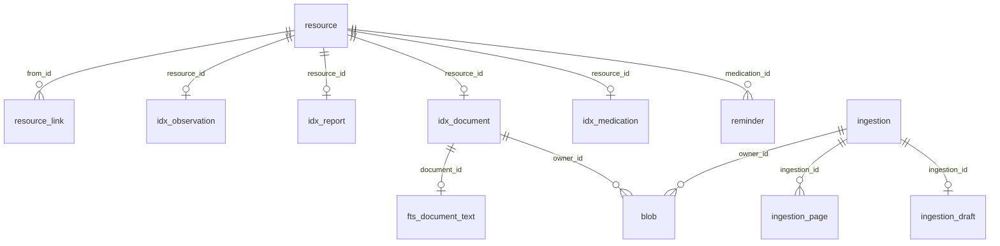

# 02. Baza de date (Room KMP + SQLCipher)

## 1. Principii

| Principiu | Ce înseamnă pentru schemă |
|---|---|
| **Resursa FHIR este sursa de adevăr** | Fiecare resursă se salvează integral, ca JSON, în tabelul `resource`. Tabelele `idx_*` sunt **derivate** și se pot reconstrui oricând din JSON |
| **Baza este criptată integral** | SQLCipher pe Android, cu o cheie derivată din cheia principală (doc. 04). Fără cheie, fișierul bazei este ilizibil |
| **Fără istoric** | O editare suprascrie rândul. Nu există tabele de versiuni sau „șterse logic” (§7.2 din plan) |
| **Ștergere reală** | `DELETE` efectiv, în cascadă, plus ștergerea fișierelor (§7) |
| **O singură persoană** | Există o singură resursă `Patient`. Nu există coloane `patient_id` |
| **Ce trebuie citit înainte de deblocare stă în afara bazei** | Cheile împachetate și programul alarmelor (fără date medicale) sunt în fișiere separate (§8) |

## 2. Deschiderea bazei

### 2.1 Codul comun (`shared:data/commonMain`)

```kotlin
@Database(
    entities = [
        ResourceEntity::class, ResourceLinkEntity::class,
        ObservationIndex::class, ReportIndex::class, DocumentIndex::class,
        MedicationIndex::class, DocumentTextFts::class,
        BlobEntity::class,
        IngestionEntity::class, IngestionPageEntity::class, IngestionDraftEntity::class,
        ReminderEntity::class, SettingEntity::class,
    ],
    version = 1,
    exportSchema = true,
)
@ConstructedBy(PatientDatabaseConstructor::class)
abstract class PatientDatabase : RoomDatabase() {
    abstract fun resources(): ResourceDao
    abstract fun index(): IndexDao
    abstract fun search(): SearchDao
    abstract fun blobs(): BlobDao
    abstract fun ingestions(): IngestionDao
    abstract fun reminders(): ReminderDao
    abstract fun settings(): SettingDao
}

@Suppress("NO_ACTUAL_FOR_EXPECT")
expect object PatientDatabaseConstructor : RoomDatabaseConstructor<PatientDatabase>
```

### 2.2 Android (`shared:data/androidMain`)

```kotlin
fun openPatientDatabase(context: Context, dbKey: ByteArray): PatientDatabase {
    System.loadLibrary("sqlcipher")
    // Cheia brută de 32 de octeți, în formatul x'…' al SQLCipher, ca să nu mai treacă prin PBKDF2.
    val rawKey = "x'${dbKey.toHex()}'".toByteArray(Charsets.US_ASCII)
    val factory = SupportOpenHelperFactory(rawKey)   // net.zetetic.database.sqlcipher
    return Room.databaseBuilder<PatientDatabase>(context, context.getDatabasePath("patient.db").absolutePath)
        .openHelperFactory(factory)
        .setJournalMode(RoomDatabase.JournalMode.WRITE_AHEAD_LOGGING)
        .build()
        .also { rawKey.fill(0) }
}
```

| Regulă | Cerință |
|---|---|
| `dbKey` = HKDF-SHA256(cheia principală, `info = "patient/db/v1"`), 32 de octeți. Detaliile sunt în doc. 04 | SEC-01, SEC-02 |
| Baza se deschide **doar după deblocare** și se închide (`close()`) la blocare. După închidere, `dbKey` se suprascrie cu zero | SEC-04 |
| `fallbackToDestructiveMigration` este **interzis**: ar șterge datele pacientului | — |
| Fișierele `-wal` și `-shm` sunt criptate de SQLCipher. Nu se copiază baza în alt loc | SEC-01 |
| Testele pe JVM folosesc `BundledSQLiteDriver`, fără criptare, cu date de test | doc. 09 |

## 3. Tabelele principale

### 3.1 `resource`: toate resursele FHIR

| Coloană | Tip | Null | Descriere |
|---|---|---|---|
| `id` | TEXT | nu | **PK.** UUID v4, același cu `Resource.id` din JSON |
| `type` | TEXT | nu | `resourceType`: `Patient`, `Observation`, `DiagnosticReport`... |
| `version_id` | INTEGER | nu | Crește la fiecare scriere; folosit doar pentru detectarea scrierilor concurente (copiat în `meta.versionId`) |
| `last_updated` | INTEGER | nu | Epoch ms UTC (copiat în `meta.lastUpdated`) |
| `verification` | TEXT | da | `unconfirmed` / `confirmed` / `manual`, copiat din `meta.tag` (doc. 03 §5). Null pentru resursele fără sens de verificare (`Device`, `AuditEvent`) |
| `json` | TEXT | nu | Resursa FHIR completă, serializată (doc. 03) |

Indexuri: `(type)`, `(type, last_updated)`.

```kotlin
@Entity(tableName = "resource", indices = [Index("type"), Index("type", "last_updated")])
data class ResourceEntity(
    @PrimaryKey val id: String,
    val type: String,
    @ColumnInfo(name = "version_id") val versionId: Long,
    @ColumnInfo(name = "last_updated") val lastUpdated: Long,
    val verification: String?,
    val json: String,
)
```

### 3.2 `resource_link`: legăturile dintre resurse

Folosit pentru ștergerea în cascadă și pentru „ce depinde de ce”, fără să parcurgem JSON-ul.

| Coloană | Tip | Null | Descriere |
|---|---|---|---|
| `from_id` | TEXT | nu | Resursa care conține referința. FK → `resource.id`, `ON DELETE CASCADE` |
| `to_id` | TEXT | nu | Resursa referită |
| `kind` | TEXT | nu | Tipul legăturii (tabelul de mai jos) |

PK: `(from_id, to_id, kind)`. Index: `(to_id)`.

| `kind` | De la → la | Câmpul FHIR |
|---|---|---|
| `report-result` | `DiagnosticReport` → `Observation` | `DiagnosticReport.result` |
| `report-performer` | `DiagnosticReport` → `Organization` | `DiagnosticReport.performer` |
| `document-report` | `DocumentReference` → `DiagnosticReport` | `DocumentReference.context.related` |
| `medication-document` | `MedicationStatement` → `DocumentReference` | `MedicationStatement.derivedFrom` |
| `medication-plan` | `MedicationStatement` → `CarePlan` | `MedicationStatement.basedOn` |
| `provenance-target` | `Provenance` → orice resursă | `Provenance.target` |
| `provenance-source` | `Provenance` → `DocumentReference` | `Provenance.entity.what` |
| `provenance-agent` | `Provenance` → `Device` | `Provenance.agent.who` |

Legăturile se scriu **în aceeași tranzacție** cu resursa, de funcția `ResourceIndexer` (§5).

## 4. Tabelele de index (derivate)

Toate au `resource_id` ca PK și FK → `resource.id` cu `ON DELETE CASCADE`. Se completează doar din JSON-ul resursei, prin `ResourceIndexer`. **Nu se scriu niciodată direct din interfață.**

### 4.1 `idx_observation`: valorile analizelor (liste, grafice)

| Coloană | Tip | Null | Sursa în FHIR |
|---|---|---|---|
| `resource_id` | TEXT | nu | `Observation.id` |
| `report_id` | TEXT | da | `DiagnosticReport` care o conține |
| `loinc` | TEXT | da | `code.coding` cu sistemul LOINC |
| `name_original` | TEXT | nu | `code.text`: denumirea exact ca în document |
| `name_key` | TEXT | nu | Cheia de grupare pentru grafice: `loinc` dacă există, altfel `name_original` normalizat (litere mici, fără diacritice, fără punctuație) |
| `effective_date` | TEXT | nu | `effectiveDateTime`, cu precizia din document (`2026-10-12` sau `2026-10-12T08:30:00+03:00`) |
| `effective_sort` | INTEGER | nu | Epoch ms pentru sortare (dacă e doar data: 00:00 ora locală a telefonului) |
| `value_kind` | TEXT | nu | `quantity` / `string` / `ratio` |
| `value_number` | REAL | da | `valueQuantity.value` |
| `value_comparator` | TEXT | da | `valueQuantity.comparator` (`<`, `<=`, `>=`, `>`) |
| `value_text` | TEXT | da | `valueString`, sau titrul (`1:160`) |
| `unit_ucum` | TEXT | da | `valueQuantity.code` |
| `unit_original` | TEXT | da | `valueQuantity.unit` (textul din document) |
| `ref_low` | REAL | da | `referenceRange[0].low.value` |
| `ref_high` | REAL | da | `referenceRange[0].high.value` |
| `ref_text` | TEXT | da | `referenceRange[0].text` (textul exact din document) |
| `flag_from_document` | TEXT | da | `interpretation.text`, **doar dacă apare în document** (ADR-0005) |
| `verification` | TEXT | nu | Copiat din `resource.verification` |

Indexuri: `(name_key, effective_sort)` pentru grafice, `(report_id)`, `(effective_sort)`.

**Graficul „evoluția unui test”** = `SELECT … FROM idx_observation WHERE name_key = ? ORDER BY effective_sort`. Dacă rezultatele au unități diferite, conversia se face **doar la afișare**, cu factorii din catalog, și se spune explicit (ING-087).

### 4.2 `idx_report`: buletinele

| Coloană | Tip | Null | Sursa |
|---|---|---|---|
| `resource_id` | TEXT | nu | `DiagnosticReport.id` |
| `document_id` | TEXT | da | `DocumentReference` legat |
| `performer_name` | TEXT | da | `Organization.name` |
| `effective_date` | TEXT | nu | `effectiveDateTime` (data recoltării) |
| `effective_sort` | INTEGER | nu | Pentru sortare |
| `issued` | INTEGER | da | `issued` |
| `result_count` | INTEGER | nu | `result.size` |

Index: `(effective_sort)`.

### 4.3 `idx_document`: documentele și notițele

| Coloană | Tip | Null | Sursa |
|---|---|---|---|
| `resource_id` | TEXT | nu | `DocumentReference.id` |
| `doc_class` | TEXT | nu | `lab-report` / `prescription` / `note` / `other` (doc. 03 §5) |
| `title` | TEXT | da | `description` |
| `date` | TEXT | nu | `date` |
| `date_sort` | INTEGER | nu | Pentru sortare |
| `blob_hash` | TEXT | da | SHA-256 al originalului (null pentru notițele scrise în aplicație) |
| `content_type` | TEXT | da | `image/jpeg`, `application/pdf`... |
| `page_count` | INTEGER | da | Numărul de pagini |

Indexuri: `(doc_class, date_sort)`, `(blob_hash)`.

### 4.4 `idx_medication`: medicamentele

| Coloană | Tip | Null | Sursa |
|---|---|---|---|
| `resource_id` | TEXT | nu | `MedicationStatement.id` |
| `name` | TEXT | nu | `medicationCodeableConcept.text` |
| `atc` | TEXT | da | Codul ATC, dacă e potrivit |
| `status` | TEXT | nu | `active` / `completed` / `stopped` / `on-hold` |
| `start_date` | TEXT | da | `effectivePeriod.start` |
| `end_date` | TEXT | da | `effectivePeriod.end` |
| `plan_id` | TEXT | da | `basedOn` → `CarePlan` |
| `dosage_text` | TEXT | da | `dosage[0].text` (textul pacientului sau din document) |

Index: `(status)`, `(plan_id)`.

### 4.5 `fts_document_text`: căutarea în text

Tabel FTS4 (Room `@Fts4`), cu tokenizer `unicode61` și `remove_diacritics=2`, ca „glicemie” să găsească „glicemíe” și „GLICEMIE”.

| Coloană | Conținut |
|---|---|
| `document_id` | `DocumentReference.id` (neindexat pentru text: `notIndexed`) |
| `content` | Textul OCR complet (ING-123) sau textul notiței |

```kotlin
@Fts4(tokenizer = FtsOptions.TOKENIZER_UNICODE61, tokenizerArgs = ["remove_diacritics=2"], notIndexed = ["document_id"])
@Entity(tableName = "fts_document_text")
data class DocumentTextFts(
    @PrimaryKey @ColumnInfo(name = "rowid") val rowId: Long = 0,
    @ColumnInfo(name = "document_id") val documentId: String,
    val content: String,
)
```

FTS nu suportă FK: rândul se șterge explicit, în aceeași tranzacție cu documentul (§7).

## 5. Scrierea resurselor: `ResourceIndexer`

Orice scriere de resursă trece prin `RecordStore.put()` / `putAll()`, implementat în `shared:data`:

```kotlin
interface RecordStore {                                   // shared:domain
    suspend fun <T : Resource> get(id: String): T?
    suspend fun putAll(resources: List<Resource>)         // o singură tranzacție
    suspend fun delete(id: String)                        // cascadă, §7
    fun observeByType(type: String): Flow<List<Resource>>
}
```

Pașii, într-o singură tranzacție Room (`useWriterConnection { it.immediateTransaction { … } }`):

1. **Validare** pe dispozitiv (doc. 03 §8). Dacă o resursă e invalidă, nu se scrie nimic.
2. `version_id` = vechiul + 1; `last_updated` = acum; se actualizează `meta` în JSON.
3. Upsert în `resource`.
4. Ștergerea vechilor rânduri `resource_link` și `idx_*` ale resursei, apoi inserarea celor noi, calculate din JSON.
5. Pentru `DocumentReference`: actualizarea `fts_document_text`.

**Reconstrucția indexului** (`RebuildIndex`): golește `resource_link`, `idx_*`, `fts_document_text` și le recalculează din `resource`. Rulează după migrări ale schemei de index și ca test de consistență (doc. 09).

## 6. Tabelele operaționale (nu sunt FHIR)

### 6.1 `blob`: fișierele originale criptate

Fișierele stau în `noBackupFilesDir/blobs/`, criptate cu Tink (criptare în flux, doc. 04). Tabelul le descrie.

| Coloană | Tip | Null | Descriere |
|---|---|---|---|
| `sha256` | TEXT | nu | **PK.** Hash-ul conținutului **original** (hex), calculat înainte de criptare |
| `file_name` | TEXT | nu | Nume aleator (UUID), fără legătură cu conținutul |
| `size_bytes` | INTEGER | nu | Dimensiunea originalului |
| `content_type` | TEXT | nu | Tipul MIME |
| `wrapped_key` | BLOB | nu | Cheia fișierului (keyset Tink), împachetată cu cheia de fișiere (doc. 04) |
| `owner_kind` | TEXT | nu | `ingestion` (ciornă) sau `document` |
| `owner_id` | TEXT | nu | ID-ul ingestiei sau al `DocumentReference` |
| `created_at` | INTEGER | nu | Epoch ms |

Index: `(owner_kind, owner_id)`.

**Ștergerea unui fișier:** se șterge rândul (deci `wrapped_key`, adică fișierul devine ilizibil) **și** fișierul de pe disc.

### 6.2 `ingestion`: ingestiile în curs (ING-001…004)

| Coloană | Tip | Null | Descriere |
|---|---|---|---|
| `id` | TEXT | nu | **PK.** UUID |
| `state` | TEXT | nu | `CREATED`, `PROCESSING`, `RECOVERABLE_ERROR`, `TO_REVIEW`, `DOCUMENT_ONLY`. Stările finale (`CONFIRMED`, `CANCELLED`) nu se păstrează: rândul se șterge |
| `last_stage` | TEXT | da | Ultima etapă terminată: `CAPTURED`, `SOURCE_DETECTED`, `PREPROCESSED`, `TEXT_EXTRACTED`, `CLASSIFIED`, `LAYOUT`, `EXTRACTED`, `NORMALIZED`, `VALIDATED` |
| `doc_class` | TEXT | da | Clasa propusă sau aleasă de pacient |
| `source_kind` | TEXT | nu | `camera`, `gallery`, `file`, `share` |
| `queue_position` | INTEGER | nu | Ordinea în coadă (ING-004) |
| `error_code` | TEXT | da | Cod tehnic, fără date medicale |
| `component_versions` | TEXT | da | JSON: versiunile motorului OCR, extractorului, catalogului (ING-140) |
| `created_at` | INTEGER | nu | Epoch ms |
| `last_opened_at` | INTEGER | da | Ultima deschidere a ciornei de către pacient (ING-002) |

Index: `(state)`, `(queue_position)`.

### 6.3 `ingestion_page`: paginile și textul extras

| Coloană | Tip | Null | Descriere |
|---|---|---|---|
| `ingestion_id` | TEXT | nu | FK → `ingestion.id`, `ON DELETE CASCADE` |
| `page_no` | INTEGER | nu | De la 1 |
| `blob_sha256` | TEXT | nu | Imaginea paginii sau PDF-ul (FK logic → `blob`) |
| `text_source` | TEXT | da | `ocr-printed`, `ocr-handwriting`, `pdf-text` |
| `text_layout` | TEXT | da | JSON `TextLayout` (PIPELINE_INGESTIE §6.1) |

PK: `(ingestion_id, page_no)`.

### 6.4 `ingestion_draft`: ciorna de revizuire

| Coloană | Tip | Null | Descriere |
|---|---|---|---|
| `ingestion_id` | TEXT | nu | **PK.** FK → `ingestion.id`, `ON DELETE CASCADE` |
| `draft_json` | TEXT | nu | JSON `ReviewDraft` (doc. 05): candidații, stările `ok` / `uncertain` / `invalid`, editările pacientului |
| `scrolled_to_end` | INTEGER | nu | 0/1: pacientul a parcurs tot documentul (condiție pentru „Confirmă tot”, ING-102) |
| `updated_at` | INTEGER | nu | Epoch ms |

### 6.5 `reminder`: mementourile

| Coloană | Tip | Null | Descriere |
|---|---|---|---|
| `id` | TEXT | nu | **PK.** UUID |
| `medication_id` | TEXT | nu | FK → `resource.id` (`MedicationStatement`), `ON DELETE CASCADE` |
| `time_of_day` | INTEGER | nu | Minute de la miezul nopții, ora locală (de exemplu 480 = 08:00) |
| `days_mask` | INTEGER | nu | Biți Luni = 1 … Duminică = 64; 127 = zilnic |
| `active` | INTEGER | nu | 0/1 |

Programul se copiază și în fișierul `alarms.json` din afara bazei (§8), pentru că după repornirea telefonului baza este blocată.

### 6.6 `setting`: setările

| Coloană | Tip | Null |
|---|---|---|
| `key` | TEXT | nu (PK) |
| `value` | TEXT | nu |

| Cheie | Valori | Implicit | Cerință |
|---|---|---|---|
| `lock.inactivity_seconds` | 60…300 | 300 | SEC-04 (doar valori mai stricte) |
| `lock.background_seconds` | 0…60 | 60 | SEC-04 |
| `screenshots.allowed` | `true`/`false` | `false` | SEC-08 |
| `export.auto.frequency` | `off`, `daily`, `weekly`, `monthly` | `off` | DAT-24 |
| `export.auto.folder_uri` | URI Storage Access Framework | — | DAT-24 |
| `export.auto.keep_last` | 1…10 | 3 | DAT-24 |
| `export.last_success_at` | Epoch ms | — | DAT-24 |
| `ingestion.draft_retention_days` | 30 | 30 | ING-002 **[Necesită răspuns]** |
| `ui.language` | `system`, `en`, `ro` | `system` | ADR-0009 |

Setările necesare **înainte** de deblocare nu stau aici, ci în `vault.json` (§8, doc. 04 §2): ștergerea după N încercări greșite (`wipe_after_failed_attempts`, SEC-33) și biometria (activă dacă `wrapped_mk_biometric` există, SEC-32).

## 7. Ștergerea

| Acțiune | Ce se șterge, într-o singură tranzacție | Apoi |
|---|---|---|
| O valoare (`Observation`) | Rândul `resource` (cascadă: `idx_observation`, legăturile ei); referința din `DiagnosticReport.result` se elimină și raportul se rescrie; `Provenance.target` se actualizează (dacă rămâne gol, se șterge) | — |
| Un buletin (`DiagnosticReport`) | Raportul, toate `Observation` din el, `Provenance` care le au ca țintă. **Întreabă** dacă se șterge și documentul original | — |
| Un document (`DocumentReference`) | Documentul, `fts_document_text`, `DiagnosticReport` și `Observation` derivate, `MedicationStatement` derivate (după confirmarea pacientului, care vede lista), `Provenance` | Ștergerea fișierelor din `blob` |
| Un medicament | `MedicationStatement`, `reminder` (cascadă), `Provenance` | Anularea alarmelor, actualizarea `alarms.json` |
| O ingestie anulată (ING-003) | `ingestion` (cascadă: pagini, ciornă) și rândurile `blob` cu `owner_kind = ingestion` | Ștergerea fișierelor |
| **Ștergerea totală** (ARH-09) | Se distrug **întâi cheile** (doc. 04): `vault.json` și cheia din Keystore | Apoi se șterg `patient.db*`, `blobs/`, `alarms.json`, fișierele temporare. Aplicația revine la ecranul de început |

Pacientul vede înainte de confirmare **ce se va șterge** (de exemplu „Se vor șterge și 24 de valori și 2 medicamente extrase din acest document”).

## 8. Fișierele din afara bazei

Toate în `noBackupFilesDir` (excluse din backup-ul sistemului, SEC-06).

| Fișier | Conținut | De ce nu e în bază | Protecție |
|---|---|---|---|
| `vault.json` | Cheile împachetate, sarea și parametrii Argon2id, contorul de încercări greșite, versiunea formatului (doc. 04) | Trebuie citit **pentru** deblocare | Nu conține secrete în clar; cheile sunt împachetate |
| `alarms.json` | Lista de alarme: `id`, `time_of_day`, `days_mask`. **Fără nume de medicamente, fără ID-uri FHIR** | După repornirea telefonului, alarmele trebuie reprogramate fără ca baza să fie deblocată | Nu conține date medicale; notificarea afișează doar „Ai un memento” (SEC-52) |
| `blobs/` | Fișierele originale criptate | Fișiere mari | Criptare Tink per fișier |
| `tmp/` | Fișiere temporare ale ingestiei | — | Criptate; golite la pornire și la finalul fiecărei ingestii (SEC-05) |

## 9. Migrările

| Regulă | Detaliu |
|---|---|
| Schema exportată | `exportSchema = true`; fișierele JSON ale schemei se pun în Git (`shared/data/schemas/`) |
| Migrări | `AutoMigration` unde se poate; altfel `Migration` scrisă manual, cu test |
| Test obligatoriu | Pentru fiecare versiune nouă: test care deschide o bază din versiunea anterioară, cu date, și verifică datele după migrare |
| Index | Dacă se schimbă doar tabelele `idx_*`, migrarea poate apela `RebuildIndex` |
| JSON FHIR | Schimbările de profil FHIR (doc. 03 §9) se fac prin migrări de date separate, versionate |
| Interzis | `fallbackToDestructiveMigration*` |

## 10. Diagrama relațiilor


