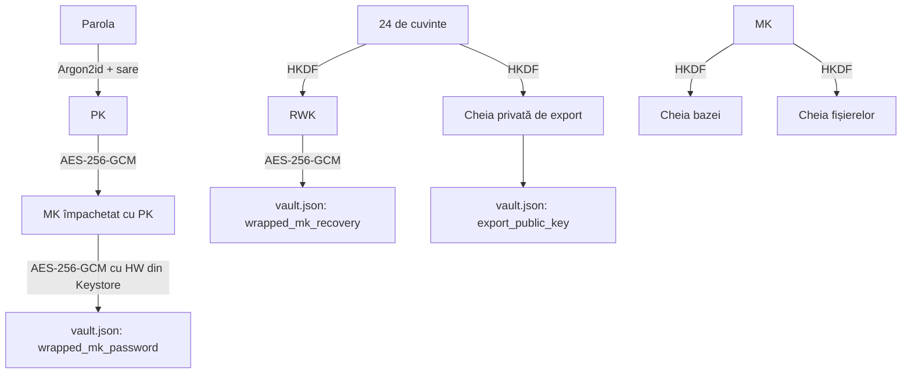
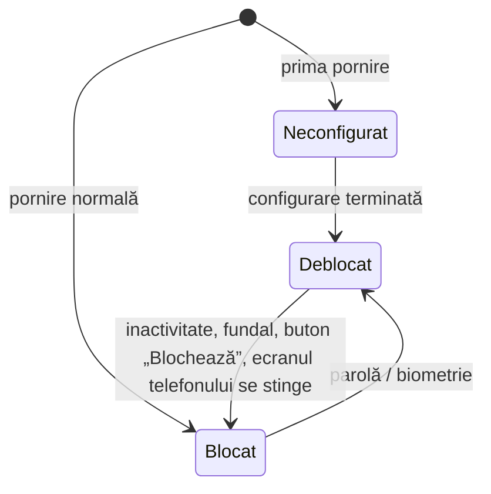

# 04. Securitate și criptare

Cerințele sunt în [ARHITECTURA_MOBILE_FIRST.md §7](../ARHITECTURA_MOBILE_FIRST.md), [SECURITATE.md](../SECURITATE.md) și [ADR-0008](../adr/0008-autentificare-locala-multifactor.md). Aici este implementarea exactă.

**Regula de bază: nu inventăm criptografie** (SEC-20). Folosim doar primitivele de mai jos, cu bibliotecile din doc. 01. Orice abatere se aprobă de arhitectură.

## 1. Cheile

| Cheie | Ce este | Unde stă | Cum se obține |
|---|---|---|---|
| **MK** (cheia principală) | 32 de octeți aleatori | **Nicăieri în clar pe disc.** Doar în memorie, cât aplicația e deblocată | Generată o singură dată, cu `SecureRandom` |
| **PK** (cheia din parolă) | 32 de octeți | Doar în memorie, câteva milisecunde | Argon2id(parolă, sare) (§3) |
| **HW** (cheia telefonului) | AES-256 în Android Keystore, neexportabilă | Keystore (StrongBox dacă există, altfel TEE) | Generată la configurare (§4) |
| **BIO** (cheia biometrică, opțională) | AES-256 în Keystore, legată de biometrie | Keystore | Generată când pacientul activează biometria (§6) |
| **RS** (secretul de recuperare) | 32 de octeți = entropia celor 24 de cuvinte | **Doar pe hârtia pacientului** | Generat la configurare, afișat o singură dată (§5) |
| **RWK** | Cheia care împachetează MK pentru recuperare | Doar în memorie | HKDF(RS, `"patient/recovery-wrap/v1"`) |
| **EXK** (perechea de export) | Pereche X25519 | Pe telefon **doar partea publică** | Partea privată = HKDF(RS, `"patient/export-kem/v1"`) |
| **DBK** | Cheia bazei de date | Doar în memorie | HKDF(MK, `"patient/db/v1"`) |
| **FKEK** | Cheia care împachetează cheile fișierelor | Doar în memorie | HKDF(MK, `"patient/file-kek/v1"`) |

Toate derivările folosesc **HKDF-SHA256** cu sare goală și `info` exact ca mai sus (șir UTF-8), ieșire de 32 de octeți.



## 2. `vault.json`

Fișier în `noBackupFilesDir`. Nu conține niciun secret în clar. Se scrie atomic (fișier temporar + redenumire).

```json
{
  "format": 1,
  "created_at": "2026-11-06T10:00:00Z",
  "kdf": { "alg": "argon2id", "salt": "<base64, 16 octeți>", "memory_kib": 65536, "iterations": 3, "parallelism": 1 },
  "hw_key_alias": "patient_hw_v1",
  "wrapped_mk_password": "<base64>",
  "wrapped_mk_recovery": "<base64>",
  "wrapped_mk_biometric": null,
  "bio_key_alias": null,
  "export_public_key": "<base64, 32 octeți X25519>",
  "failed_attempts": 0,
  "wipe_after_failed_attempts": 0,
  "lockout_until_elapsed": 0,
  "lockout_boot_count": 0
}
```

### Formatul unui text criptat (AES-256-GCM)

Toate câmpurile `wrapped_*` au același format: `nonce (12 octeți) || ciphertext || tag (16 octeți)`, în base64. Fiecare are **date asociate (AAD)** diferite, ca să nu poată fi schimbate între ele:

| Câmp | AAD (UTF-8) |
|---|---|
| Stratul interior cu PK | `"patient/mk/password/v1"` |
| Stratul exterior cu HW | `"patient/mk/hw/v1"` |
| `wrapped_mk_recovery` | `"patient/mk/recovery/v1"` |
| `wrapped_mk_biometric` | `"patient/mk/bio/v1"` |
| Cheile fișierelor (`blob.wrapped_key`) | `"patient/blob/" + sha256` |

Pentru AES-GCM cu cheile din memorie se folosește Tink (`AesGcmKey` creată din octeți bruți, prin API-ul de chei Tink). Pentru HW și BIO se folosește `javax.crypto.Cipher("AES/GCM/NoPadding")` cu cheia din Keystore (nonce generat de Keystore).

## 3. Parola

### 3.1 Politica (SEC-31)

| Regulă | Valoare |
|---|---|
| Lungime minimă | 8 caractere (după normalizare). Interfața recomandă o frază |
| Lungime maximă | Cel puțin 64 de caractere acceptate |
| Caractere | Orice caracter Unicode, inclusiv spații; normalizare NFKC înainte de derivare |
| Reguli de compunere | **Niciuna** (fără „o majusculă, o cifră”) |
| Expirare | **Niciuna** |
| Lista de parole interzise | Fișier local cu cele mai comune ~10.000 de parole + cuvinte legate de aplicație („patient”, „parola123”). Verificare fără diferență între litere mari și mici |
| Afișare | Buton „arată parola”; fără indicii (hint) salvate |
| Tastatură | Câmp de tip parolă, fără sugestii și fără învățare (`KeyboardType.Password`, `autoCorrect = false`) |

### 3.2 Argon2id (SEC-21)

- Bouncy Castle: `Argon2BytesGenerator` cu `Argon2Parameters.ARGON2_id`, versiunea 1.3.
- Sare: 16 octeți aleatori, generată la configurare și la fiecare schimbare de parolă.
- Parametri implicți: `memory = 64 MiB`, `iterations = 3`, `parallelism = 1`, ieșire 32 de octeți.
- **Calibrare la configurare:** se măsoară timpul; dacă e sub 0,5 s, se cresc `iterations` până la ≥ 0,5 s (maximum 10). Dacă telefonul nu are memorie (eroare), se coboară la 32 MiB și se cresc iterațiile. Parametrii aleși se salvează în `vault.json`.
- Derivarea rulează pe `Dispatchers.Default`, cu indicator de progres.

### 3.3 Configurarea (prima pornire)

1. Verifică `KeyguardManager.isDeviceSecure`. Dacă telefonul nu are blocare de ecran, aplicația explică și nu continuă (SEC-34).
2. Generează **MK** (32 de octeți) și **RS** (32 de octeți).
3. Generează cheia **HW** (§4).
4. Pacientul alege parola → **PK** = Argon2id.
5. `inner = AES-GCM(PK, MK, aad="patient/mk/password/v1")`; `wrapped_mk_password = AES-GCM(HW, inner, aad="patient/mk/hw/v1")`.
6. `RWK = HKDF(RS, "patient/recovery-wrap/v1")`; `wrapped_mk_recovery = AES-GCM(RWK, MK, aad=...)`.
7. `export_private = HKDF(RS, "patient/export-kem/v1")` → cheia publică X25519 → `export_public_key`. **Cheia privată se șterge imediat din memorie.**
8. Afișează cele 24 de cuvinte (§5) și verifică notarea lor.
9. Scrie `vault.json`. Suprascrie cu zero PK, RS, RWK și cheia privată de export.
10. Deschide baza cu DBK și creează resursele inițiale (`Patient`, `Consent`).

### 3.4 Deblocarea cu parola

1. Verifică blocarea temporară (§3.6). Dacă e activă, arată cât mai trebuie așteptat.
2. PK = Argon2id(parola, sare).
3. `inner = AES-GCM-decrypt(HW, wrapped_mk_password)`. Dacă cheia HW lipsește sau a fost invalidată: ecranul de recuperare (§5.3).
4. `MK = AES-GCM-decrypt(PK, inner)`. Dacă eșuează (tag invalid): parolă greșită → `failed_attempts++`.
5. Succes: `failed_attempts = 0`; derivă DBK și FKEK; deschide baza; reînnoiește blobul biometric (§6).

### 3.5 Schimbarea parolei

Cere parola veche (sau deblocare recentă < 1 minut), apoi repetă pașii 4–5 din §3.3 cu o sare nouă. **MK nu se schimbă**, deci nimic nu trebuie recriptat.

### 3.6 Încercările greșite (SEC-33)

| Încercări greșite consecutive | Așteptare înainte de următoarea |
|---|---|
| 1–4 | Fără |
| 5 | 30 de secunde |
| 6 | 1 minut |
| 7 | 5 minute |
| 8 | 15 minute |
| 9 și peste | 1 oră |

- Așteptarea folosește `SystemClock.elapsedRealtime()` + numărul de porniri ale telefonului (`Settings.Global.BOOT_COUNT`), ca schimbarea orei să nu o anuleze.
- Dacă pacientul a activat **ștergerea automată** (`wipe_after_failed_attempts` = N în `vault.json`, între 10 și 20; implicit 0 = dezactivat), la a N-a încercare greșită se face ștergerea totală (§9). Activarea cere confirmare dublă și explicație clară.
- **Limită cunoscută** (se trece în DPIA): contorul din `vault.json` poate fi resetat de cineva cu root. Protecția reală împotriva ghicirii parolei este costul Argon2id plus faptul că cheia HW nu poate ieși de pe telefon.

## 4. Cheia telefonului (HW)

```kotlin
val spec = KeyGenParameterSpec.Builder("patient_hw_v1", PURPOSE_ENCRYPT or PURPOSE_DECRYPT)
    .setKeySize(256)
    .setBlockModes(BLOCK_MODE_GCM)
    .setEncryptionPaddings(ENCRYPTION_PADDING_NONE)
    .setUnlockedDeviceRequired(true)      // folosibilă doar cu telefonul deblocat
    .setIsStrongBoxBacked(strongBoxAvailable)
    .build()
```

- `strongBoxAvailable` = `packageManager.hasSystemFeature(FEATURE_STRONGBOX_KEYSTORE)`. Dacă generarea cu StrongBox eșuează (`StrongBoxUnavailableException`), se încearcă fără.
- Cheia HW **nu** cere autentificare la fiecare folosire: factorul „ce știi” este parola aplicației, verificată criptografic prin PK.
- Ce tip de keystore a fost folosit (StrongBox / TEE / software) se afișează în ecranul „Securitate” și se notează în `AuditEvent` la configurare. Dacă cheia este doar software (telefoane foarte vechi), aplicația avertizează.

## 5. Cheia de recuperare (24 de cuvinte, SEC-35)

### 5.1 Generarea și afișarea

- Standard **BIP-39**: 256 de biți de entropie (RS) + 8 biți de control = 24 de cuvinte din **lista engleză** de 2048 de cuvinte (singura listă standard; cuvintele simple în engleză se scriu ușor și de vorbitorii de română).
- Implementare proprie a BIP-39 (este doar codificare, nu criptografie): lista oficială inclusă ca resursă, cu test pe vectorii oficiali BIP-39. **Nu se folosește** derivarea BIP-39 cu PBKDF2 („seed”); RS este direct entropia.
- Ecranul: 24 de cuvinte numerotate, `FLAG_SECURE` **mereu** activ (chiar dacă pacientul a permis capturile), fără copiere în clipboard.
- Textul: „Notează aceste 24 de cuvinte pe hârtie și păstrează-le în siguranță. Fără ele și fără parolă, datele nu pot fi recuperate de nimeni, nici de noi. Cu ele poți deschide orice export” (SEC-36).
- Verificarea: pacientul alege cuvintele corecte pentru 3 poziții aleatorii. Fără verificare, configurarea nu se termină.

### 5.2 Introducerea cuvintelor

Câmp cu sugestii din lista BIP-39 (după primele litere), verificarea sumei de control înainte de continuare, mesaj clar dacă un cuvânt nu există.

### 5.3 Folosirea

| Situație | Pași |
|---|---|
| **Parolă uitată** (același telefon) | Cuvinte → RS → RWK → MK din `wrapped_mk_recovery` → pacientul alege o parolă nouă → se refac `wrapped_mk_password` (și cheia HW, dacă a fost invalidată) |
| **Cheia HW pierdută sau invalidată** (de exemplu după resetarea blocării de ecran pe unele telefoane) | Ca mai sus |
| **Telefon nou / reinstalare** | Doar prin import dintr-un export (doc. 07) |

## 6. Biometria (opțională, SEC-32)

- Cheia **BIO**: AES-256 GCM în Keystore, cu `setUserAuthenticationRequired(true)`, `setUserAuthenticationParameters(0, AUTH_BIOMETRIC_STRONG)` (API 30+; pe API 28–29: `setUserAuthenticationValidityDurationSeconds(-1)`), `setInvalidatedByBiometricEnrollment(true)`.
- `wrapped_mk_biometric = AES-GCM(BIO, payload, aad="patient/mk/bio/v1")`, unde `payload` = MK + o **politică semnată implicit de GCM**:

```json
{ "boot_count": 412, "password_unlock_at": "2026-11-06T10:00:00Z" }
```

- La deblocarea biometrică (`BiometricPrompt` cu `CryptoObject`): după decriptare, aplicația verifică politica. Se cere **parola** (și biometria se refuză) dacă:
  - `boot_count` diferă de cel curent (telefonul a fost repornit);
  - au trecut **7 zile** de la `password_unlock_at`;
  - cheia BIO a fost invalidată (amprentă sau față nouă adăugată în sistem: `KeyPermanentlyInvalidatedException`).
- Politica nu poate fi modificată fără cheia BIO, pentru că e în interiorul textului criptat.
- După fiecare deblocare cu parolă, blobul biometric se rescrie cu politica actualizată.

## 7. Fișierele criptate

- Fiecare fișier original are cheia lui: un keyset Tink **`AES256_GCM_HKDF_1MB`** (`StreamingAead`), generat la salvare.
- Keyset-ul se serializează și se criptează cu **FKEK** (AES-256-GCM, AAD = `"patient/blob/" + sha256`), apoi se salvează în `blob.wrapped_key` (doc. 02 §6.1).
- Fișierul de pe disc: `noBackupFilesDir/blobs/<uuid>`, criptat în flux. Date asociate pentru flux: `sha256` (hex, UTF-8).
- Ștergerea unui rând `blob` face fișierul ilizibil chiar dacă ștergerea de pe disc eșuează.
- La citire, după decriptare, se recalculează SHA-256 și se compară cu cel salvat (integritate).

**Fișierele temporare** (pagini în procesare, imagini intermediare) se criptează la fel, cu o cheie temporară a ingestiei, în `noBackupFilesDir/tmp/<ingestionId>/`. Directorul `tmp/` se golește la pornirea aplicației și la finalul fiecărei ingestii (SEC-05).

## 8. Blocarea automată (SEC-04)

### 8.1 Stările



### 8.2 Reguli

| Regulă | Implementare |
|---|---|
| Inactivitate | Implicit **5 minute**: orice atingere sau tastare resetează cronometrul (interceptare în `Activity.dispatchTouchEvent` / `dispatchKeyEvent`) |
| Fundal | Implicit **1 minut**: la `ON_STOP` din `ProcessLifecycleOwner` se notează momentul; la revenire sau la expirare, blocare |
| Excepții | Camera proprie, selectorul de fișiere, selectorul de poze și meniul de partajare **deschise de aplicație** nu declanșează blocarea de fundal: un indicator `externalActivityInProgress` este setat înainte de lansare și resetat la rezultat, cu limită de 10 minute |
| Setările pacientului | Doar valori **mai stricte** (doc. 02 §6.6) |
| Ecranul stins | `ACTION_SCREEN_OFF` → blocare imediată |
| La blocare | Se închide baza; se suprascriu cu zero MK, DBK, FKEK; se golesc cache-urile de imagini decriptate și ViewModel-urile cu date; navigarea se resetează la ecranul de blocare |
| Lucrul în curs | Ingestia se oprește la ultimul checkpoint și continuă după deblocare (ING-001). Exportul automat în curs se anulează și se reia la următoarea deblocare |

## 9. Ștergerea totală (ARH-09, SEC-03)

Ordinea este importantă: **întâi cheile**, apoi datele.

1. Confirmare dublă: pacientul scrie un cuvânt de confirmare (de exemplu „ȘTERGE” / „DELETE”).
2. Închide baza; suprascrie cu zero cheile din memorie.
3. Șterge cheile din Keystore (`patient_hw_v1`, cheia BIO).
4. Suprascrie `vault.json` cu zero și îl șterge.
5. Șterge `patient.db`, `patient.db-wal`, `patient.db-shm`, `blobs/`, `tmp/`, `alarms.json`; anulează toate alarmele și notificările.
6. Repornește aplicația la ecranul de bun venit.

Dacă procesul se întrerupe după pasul 3, datele rămase sunt ilizibile; la pornire, aplicația detectează starea incompletă și termină ștergerea.

## 10. Alte protecții

| Cerință | Implementare |
|---|---|
| Capturi de ecran (SEC-08) | `FLAG_SECURE` pe fereastra principală, implicit. Dacă pacientul permite capturile (după avertisment): se scoate `FLAG_SECURE`, dar previzualizarea din lista de aplicații recente rămâne ascunsă: `setRecentsScreenshotEnabled(false)` pe API 33+, iar pe API 28–32 `FLAG_SECURE` se pune înapoi la `onPause` și se scoate la `onResume`. Ecranul cuvintelor de recuperare are mereu `FLAG_SECURE` |
| Clipboard (SEC-07) | Copiere doar la acțiunea explicită a pacientului; `ClipDescription.EXTRA_IS_SENSITIVE = true` (API 33+); golire automată după 60 de secunde |
| Root / jailbreak (SEC-70) | Verificări locale simple (binarul `su`, căi Magisk, `ro.build.tags` cu `test-keys`, `ro.debuggable`). Dacă se detectează: **un singur avertisment**, apoi aplicația continuă. Starea apare în ecranul „Securitate” |
| Depanare | În lansare: verificare `Debug.isDebuggerConnected()` → doar avertisment, ca la root |
| Componente exportate (SEC-51) | Doar activitatea principală și cea care primește documente partajate. Datele primite se procesează **doar după deblocare** |
| Notificări (SEC-52) | Text generic. Detalii doar în aplicație, după deblocare (doc. 06) |
| Memorie | Cheile ca `ByteArray`, suprascrise cu `fill(0)` după folosire. Parola ca `CharArray`, nu `String` (pe cât permite Compose; câmpul de parolă se golește imediat după derivare) |

## 11. Ce verifică testul de penetrare extern (SEC-94)

Lista de mai sus se transformă în cazuri de test MASTG. Dezvoltatorul păstrează în repository un fișier `SECURITY_NOTES.md` cu: ce tip de keystore folosește fiecare telefon de test, abaterile acceptate și motivul lor.
