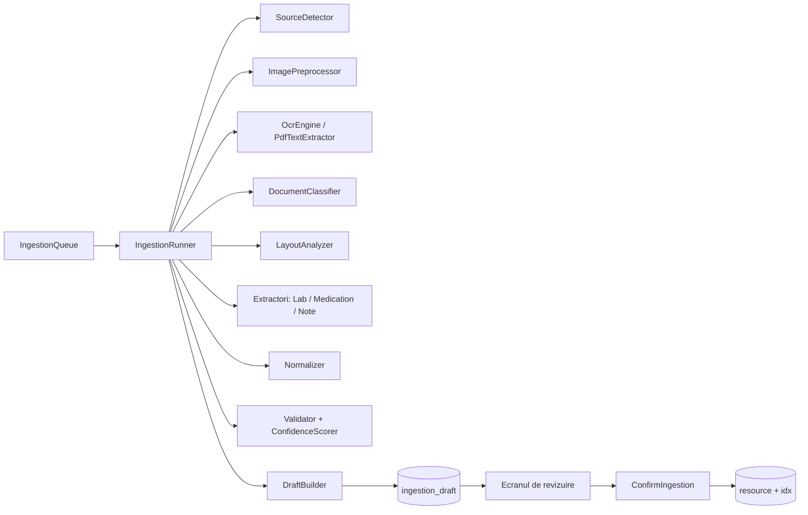

# 05. Citirea documentelor (pipeline-ul de ingestie)

Specificația funcțională completă este în [PIPELINE_INGESTIE.md](../PIPELINE_INGESTIE.md) (cerințele `ING-xxx`). Aici este implementarea: clasele, algoritmii, formatele intermediare și ordinea pașilor.

**Aceasta este cea mai complexă parte a primei versiuni.** Recomandare: se construiește etapă cu etapă, fiecare cu teste pe fișierele de referință (doc. 09), înainte de etapa următoare.

## 1. Arhitectura



| Componentă | Modul | Platformă |
|---|---|---|
| `IngestionQueue`, `IngestionRunner` | `shared:ingestion` | comun |
| `SourceDetector`, `DocumentClassifier`, `LayoutAnalyzer`, extractorii, `Normalizer`, `Validator`, `ConfidenceScorer`, `DraftBuilder` | `shared:ingestion` | comun (Kotlin pur, testat pe JVM) |
| `ImagePreprocessor`, `OcrEngine`, `HandwritingRecognizer`, `PdfTextExtractor`, `PdfPageRenderer` | port în `shared:domain`, implementare în `shared:platform/androidMain` | Android |
| `ConfirmIngestion` | `shared:domain` | comun |

### Rularea

- Ingestiile rulează **doar cât aplicația e deblocată**, într-o coroutine din domeniul aplicației (`applicationScope`), pe `Dispatchers.Default`. **Nu** se folosește WorkManager: fără chei, datele nu pot fi citite.
- O singură ingestie procesată odată (ING-004); celelalte așteaptă în coadă (`queue_position`).
- După fiecare etapă: se salvează rezultatul și `last_stage` (checkpoint, ING-001). La blocare, procesarea se oprește; la deblocare, se reia de la ultimul checkpoint.
- Fiecare etapă are **limită de timp** (de exemplu 60 s pe pagină pentru OCR) și de memorie (§3.3). La depășire: `RECOVERABLE_ERROR` cu cod, fără date medicale în cod.

## 2. Formatele intermediare (Kotlin, `commonMain`)

```kotlin
@Serializable data class BBox(val x: Int, val y: Int, val w: Int, val h: Int)

@Serializable data class TextLayout(                       // PIPELINE_INGESTIE §6.1
    val page: Int, val width: Int, val height: Int,
    val source: TextSource,                                 // OCR_PRINTED, OCR_HANDWRITING, PDF_TEXT
    val engine: EngineInfo,
    val lines: List<TextLine>,
)
@Serializable data class TextLine(val text: String, val bbox: BBox, val confidence: Double,
                                  val handwritten: Boolean, val words: List<TextWord>)
@Serializable data class TextWord(val text: String, val bbox: BBox, val confidence: Double)

@Serializable data class Table(val page: Int, val section: String?, val header: List<String>,
                               val columns: List<ColumnRole>, val rows: List<TableRow>)
enum class ColumnRole { NAME, VALUE, UNIT, REFERENCE, FLAG, OTHER }
@Serializable data class TableRow(val index: Int, val cells: List<Cell>, val lineRefs: List<Int>)
@Serializable data class Cell(val role: ColumnRole, val text: String, val bbox: BBox, val confidence: Double)

@Serializable data class Field<T>(
    val raw: String,                // exact ca în document
    val value: T?,                  // interpretat
    val bbox: BBox?, val page: Int?,
    val confidence: Double,
    val state: FieldState,          // OK, UNCERTAIN, INVALID
    val reasons: List<String>,      // coduri: "handwritten", "ocr-fix", "low-confidence", "ambiguous-decimal"…
    val edited: Boolean = false,
)
```

Candidații (`LabCandidate`, `MedicationCandidate`) urmează exact JSON-urile din PIPELINE_INGESTIE §9.1 și §9.2, cu fiecare câmp de tip `Field`.

### `ReviewDraft` (salvat în `ingestion_draft.draft_json`)

```kotlin
@Serializable data class ReviewDraft(
    val docClass: DocClass,                       // LAB_REPORT, PRESCRIPTION, NOTE, OTHER
    val pages: Int,
    val report: ReportMeta?,                      // laborator, data recoltării, data eliberării
    val lab: List<LabCandidate>,
    val medications: List<MedicationCandidate>,
    val medicationConfirmed: Map<Int, Boolean>,   // ING-103: confirmare unul câte unul
    val note: Field<String>?,
    val warnings: List<DraftWarning>,             // NAME_MISMATCH, POSSIBLE_DUPLICATE, UNSUPPORTED_LANGUAGE…
    val fullText: String,                         // textul OCR complet (ING-123)
)
```

## 3. Etapele

### 3.1 Captură și import (ING-010…015)

| Sursă | Implementare | Reguli |
|---|---|---|
| Camera | CameraX `ImageCapture` cu `OnImageCapturedCallback` (în memorie) | **Nu** se scrie în galerie / `MediaStore`. Imaginea se criptează imediat în `tmp/` |
| Galerie | Photo Picker (`PickVisualMedia`), fără permisiuni de stocare | Copiere imediată în `tmp/`, criptat |
| PDF | `ACTION_OPEN_DOCUMENT` cu `application/pdf` | La fel |
| „Partajează cu Patient” | Activitate cu `ACTION_SEND` / `ACTION_SEND_MULTIPLE` (`image/*`, `application/pdf`) | Dacă aplicația e blocată: întâi ecranul de deblocare, apoi copierea (permisiunea URI rămâne valabilă cât trăiește activitatea) |
| Mai multe pagini | Pacientul adaugă pagini una după alta; le poate reordona și șterge înainte de procesare | Maximum 20 de pagini și 50 MB per document (ING-013) |

- **EXIF** (ING-014): se aplică orientarea, apoi imaginea se re-encodează (JPEG, calitate 90) **fără metadate**. Originalul salvat ca document este această versiune curățată.
- **Calitatea** (ING-011): avertisment (nu blocare) dacă imaginea e neclară (varianța Laplacianului sub prag), prea întunecată sau prea mică (latura mică sub 1000 px).
- **Decupare**: ecran simplu cu 4 colțuri ajustabile și corecție de perspectivă (implementare proprie cu `Matrix.setPolyToPoly`). **Nu** se folosește scanerul de documente ML Kit (rulează prin Google Play Services).

### 3.2 Tipul sursei (ING-020…023)

Pentru PDF, **pe fiecare pagină**:

1. PdfBox-Android: extragerea textului cu poziții (subclasă `PDFTextStripper` care colectează `TextPosition` → `TextWord`).
2. Textul paginii este **valid** dacă: cel puțin 50 de caractere; sub 5% caractere nerecunoscute (`�`, controale); cel puțin 40% din cuvintele de ≥ 3 litere există în dicționarul local EN/RO (lista din catalog). Pragurile se calibrează pe setul de test.
3. Pagină validă → `TextLayout` cu `source = PDF_TEXT`, `confidence = 1.0`.
4. Pagină invalidă → randare cu `android.graphics.pdf.PdfRenderer` la 300 dpi → OCR.

**Izolare (SEC-61):** parsarea PDF și decodarea imaginilor rulează cu limite de timp și memorie. Recomandat (obligatoriu înainte de beta): un serviciu în proces separat izolat (`android:process=":parser"`, `android:isolatedProcess="true"`), care primește octeții și întoarce `TextLayout` / bitmap-uri. Un PDF malițios care blochează sau atacă parserul nu afectează procesul principal, care ține cheile.

### 3.3 Pre-procesarea imaginii (ING-030…032)

- Redimensionare: latura lungă maximum 3000 px (decodare cu `inSampleSize`, apoi scalare).
- Corecție de rotație: dacă OCR găsește puțin text, se încearcă 90°/180°/270° și se păstrează rotația cu cel mai mult text recunoscut.
- Fără filtre agresive (binarizare) în prima versiune: ML Kit lucrează mai bine pe imaginea naturală. Se reevaluează după benchmark.
- Imaginile intermediare doar în memorie sau în `tmp/` criptat (ING-032). Bitmap-urile se reciclează imediat.

### 3.4 OCR

**Text tipărit: ML Kit Text Recognition v2 (Latin), varianta inclusă.**

| ML Kit | `TextLayout` |
|---|---|
| `Text.TextBlock` → `Line` | `TextLine` (`text`, `boundingBox` → `bbox`, `confidence`) |
| `Line.elements` | `TextWord` (`confidence` per element) |
| Lipsa scorului | Se estimează și se notează în `EngineInfo` (ING-041) |

**Diacriticele românești** (ING-040): după OCR, `ş` → `ș`, `ţ` → `ț`, `Ş` → `Ș`, `Ţ` → `Ț`.

**Scrisul de mână: port `HandwritingRecognizer`, implementarea se alege după benchmark.**

```kotlin
interface HandwritingRecognizer {
    val available: Boolean
    suspend fun recognize(image: PageImage, regions: List<BBox>): List<TextLine>   // handwritten = true
}
```

- ML Kit **nu** recunoaște bine scrisul de mână din fotografii (ML Kit Digital Ink lucrează doar cu trăsături desenate pe ecran). Variantele de testat în benchmark: modele de recunoaștere a scrisului de mână rulate local (de exemplu prin LiteRT/ONNX Runtime), cu licență compatibilă și dimensiune rezonabilă. **Alegerea se face de arhitectură după benchmark**; adăugarea unei biblioteci noi cere aprobare.
- **Până atunci**, implementarea `NoHandwritingRecognizer` (`available = false`): liniile cu încredere mică ML Kit sunt marcate `UNCERTAIN` cu motivul `possibly-handwritten`, iar aplicația afișează ING-043: „Scrisul de mână nu a putut fi citit. Poți introduce manual.”, cu imaginea alături.
- Detectarea regiunilor scrise de mână: euristică (linii cu încredere ML Kit mică, înălțime neregulată a caracterelor). Se îmbunătățește odată cu motorul ales.

### 3.5 Clasificarea (ING-050…052)

Scor pe clase, din cuvinte-cheie (EN și RO, fără diacritice, litere mici) și structură:

| Semnal | `lab-report` | `prescription` | `note` |
|---|---|---|---|
| Cuvinte: „laboratory”, „buletin de analize”, „reference range”, „interval de referinta”, „valori de referinta”, „rezultat”, „result” | +3 fiecare | | |
| Tabel cu ≥ 3 rânduri care au număr + unitate | +5 | | |
| Cuvinte: „rx”, „reteta”, „prescription”, „tablets”, „comprimate”, „mg”, „de ori pe zi”, „times daily” | | +2 fiecare | |
| Proporția de text scris de mână > 60% și fără tabel | | +1 | +4 |

- Clasa cu scorul cel mai mare, dacă scorul ≥ 5; altfel `other`.
- Pacientul vede clasa propusă și o poate schimba (ING-051). Schimbarea reia extragerea de la etapa 7.

### 3.6 Analiza layout-ului (ING-060…064)

Algoritmul pentru tabelele de rezultate:

1. **Rânduri:** liniile sortate după `y`; două linii sunt pe același rând dacă se suprapun vertical ≥ 50% din înălțimea mai mică.
2. **Antetul tabelului:** primul rând care conține ≥ 2 cuvinte-cheie de coloană: `NAME` („test”, „analiza”, „investigatia”, „parameter”), `VALUE` („result”, „rezultat”, „valoare”), `UNIT` („units”, „u.m.”, „um”, „unitati”), `REFERENCE` („reference”, „referinta”, „interval”, „valori normale”, „normal range”), `FLAG` („flag”).
3. **Coloane:** limitele de coloană = mijlocul spațiului dintre centrele cuvintelor-cheie din antet. Fără antet: grupare după alinierea pe `x` a celulelor numerice (coloana cu cele mai multe numere = `VALUE`).
4. **Celule:** fiecare cuvânt merge în coloana în care cade centrul lui.
5. **Secțiuni (ING-063):** un rând fără valoare numerică, cu text pe toată lățimea sau cu font mai mare, devine `section` pentru rândurile următoare („Biochimie”, „Hemoleucograma”, „Urinalysis”).
6. **Continuare pe pagina următoare (ING-062):** dacă pagina următoare repetă antetul sau are aceleași limite de coloană (±5% din lățime), tabelele se unesc.
7. **Metadate (ING-073):** în afara tabelului se caută: data recoltării („data recoltarii”, „collection date”, „collected”), data eliberării („data eliberarii”, „report date”, „issued”), laboratorul (primul bloc de sus, sau linia cu „laborator”, „laboratory”, „SRL”, „Ltd”), numele pacientului („pacient”, „patient”, „nume”).

### 3.7 Extragerea

**Analize (ING-070…075)**, pe fiecare rând de tabel:

| Câmp | Regulă |
|---|---|
| `name` | Celula `NAME`. Rândurile fără nume sau fără valoare nu devin candidați (titluri, comentarii) |
| `value` | Celula `VALUE`, recunoscută cu expresiile de mai jos |
| `unit` | Celula `UNIT`; dacă lipsește, textul de după număr în celula `VALUE` |
| `referenceRange` | Celula `REFERENCE`, recunoscută cu expresiile de mai jos |
| `flag` | Celula `FLAG` sau simbolul lipit de valoare (`5.4 H`, `↑`, `*`). **Doar dacă apare în document** (ING-072) |

Expresiile pentru valori (după înlocuirea `−` cu `-` și eliminarea spațiilor din interiorul numerelor):

| Formă | Expresie (simplificată) | Rezultat |
|---|---|---|
| Comparator | `^(<=|>=|≤|≥|<|>)\s*(NUM)$` | `comparator` + număr |
| Număr | `^(NUM)$`, cu `NUM = \d{1,3}([ .,]\d{3})*([.,]\d+)?|\d+([.,]\d+)?` | număr (separatorul se rezolvă la §3.8) |
| Titru | `^1\s*:\s*\d+$` | `ratio` |
| Interval ca valoare | `^(NUM)\s*[-–]\s*(NUM)\s*(.*)$` în coloana `VALUE` | `range` (text) |
| Calitativ | Listă: negative, positive, negativ, pozitiv, absent, absente, traces, urme, `+`…`++++` | `qualitative` |
| Altceva | — | `text` |

Intervale de referință: `NUM - NUM`, `(NUM; NUM)`, `< NUM`, `> NUM`, `up to NUM`, `pana la NUM`, forme pe sex (`M: … F: …`, `B: … F: …`) → păstrate integral ca text (ING-071).

**Medicamente (ING-090…093):** pe linii (rețetele rar au tabele): denumire = cuvântul (cuvintele) găsit(e) în catalogul de medicamente sau linia care începe cu majusculă urmată de o concentrație (`\d+([.,]\d+)?\s*(mg|g|ml|mcg|µg|ui|iu)`); forma (`tablets`, `comprimate`, `capsule`, `sirop`); schema = restul liniei și linia următoare; durata (`\d+\s*(zile|days|saptamani|weeks)`).

**Transformarea schemei în ore (ING-091)**, doar pentru formele neambigue:

| Text | Structură propusă |
|---|---|
| „once daily”, „o dată pe zi”, „1 x/zi” | `frequency = 1`, ora propusă 08:00 |
| „twice daily”, „de 2 ori pe zi”, „2 x/zi” | `frequency = 2`, orele propuse 08:00, 20:00 |
| „three times daily”, „de 3 ori pe zi”, „3 x/zi” | 08:00, 14:00, 20:00 |
| Ore explicite („8:00 și 20:00”) | Exact orele din text |
| „după masă” / „after meals” | `when = PC` (doar informativ) |
| Orice altceva | Fără structură; pacientul completează |

Orele propuse sunt **doar o sugestie**, pe care pacientul o confirmă sau o schimbă.

**Notițe (ING-095, ING-096):** tot textul, cu paragrafele păstrate (linie goală când distanța verticală > 1,5 × înălțimea liniei). Data: prima dată găsită în text, altfel ziua importului.

### 3.8 Normalizarea (ING-080…088)

**Separatorul zecimal (ING-081)**, per document:

1. Se numără numerele din coloana `VALUE` și din intervale cu forma `d,d` și `d.d`.
2. Dacă una domină clar (≥ 80%), ea este separatorul zecimal al documentului.
3. Forme ambigue (`1,250`, `1.250`): se aleg după unitate și interval (de exemplu un interval `150-400` sugerează mii, nu zecimale). Dacă rămân ambigue: `UNCERTAIN` cu motivul `ambiguous-decimal`.

**Corecturile OCR (ING-088):** doar în câmpurile numerice, doar dacă rezultatul devine valid: `O`/`o` → `0`, `l`/`I`/`|` → `1`, `S` → `5`, `B` → `8`. Fiecare corectură: −0,15 la încredere și motivul `ocr-fix`.

**Denumirea → LOINC (ING-080, ING-083…085):**

1. Cheie normalizată: litere mici, fără diacritice, fără punctuație, spații unice.
2. Căutare exactă în aliasurile din catalog.
3. Dacă aliasul are mai multe teste (de exemplu „leucocite” în sânge și în urină): se alege după `section` și `specimenHint`. Fără context: **fără LOINC**, doar `lab-local`.
4. Fără potrivire exactă: distanța Levenshtein ≤ 1 pentru cuvinte de 5–8 litere, ≤ 2 peste 8 litere → `UNCERTAIN` cu `fuzzy-name`.
5. Denumirea originală se păstrează mereu (`code.text`).

**Unitățile (ING-086):** tabel de aliasuri din catalog (`mmol/l` → `mmol/L`, `g/dl` → `g/dL`, `x10^9/l`, `10*9/L`, `G/L` → `10*9/L`, `µmol/l`/`umol/l` → `umol/L`, `ммоль/л` → `mmol/L`). Unitate necunoscută: rămâne doar textul, fără UCUM, `UNCERTAIN` cu `unknown-unit`. **Fără conversia valorilor** (ING-087).

**Datele (ING-082):** `DD.MM.YYYY`, `DD/MM/YYYY`, `YYYY-MM-DD`, `DD.MM.YY`, luni în cuvinte EN/RO. `MM/DD/YYYY` doar dacă documentul e în engleză și există indicii (zi > 12 în altă dată din document). Ambiguitate → `UNCERTAIN`.

### 3.9 Validarea și încrederea (ING-110…114)

**Verificări pe rând** → `INVALID` dacă eșuează:

- unitatea nu este compatibilă cu testul (din catalog), când testul are LOINC;
- valoarea numerică este în afara **limitelor fizic plauzibile** din catalog (nu intervale clinice!);
- intervalul de referință are `low ≥ high`.

**Verificări pe document:**

- data recoltării lipsește → câmpul data este `INVALID` (pacientul trebuie să o completeze);
- data este în viitor → `INVALID`;
- același test de două ori cu valori diferite, fără secțiuni diferite → ambele `UNCERTAIN`;
- același laborator + aceeași dată + aceleași valori ca un raport existent → avertisment `POSSIBLE_DUPLICATE` (ING-114);
- numele din document diferă clar de numele din profil (distanță > 30% din lungime, după normalizare) → avertisment `NAME_MISMATCH`, **fără blocare** (ING-074).

**Scorul unui câmp** (ING-112), versiunea 1:

```
confidence = ocrConfidence × layoutConfidence × normalizationConfidence − penalizări
```

- `ocrConfidence`: media încrederii cuvintelor din câmp;
- `layoutConfidence`: 1,0 cu antet de tabel găsit; 0,8 fără antet;
- `normalizationConfidence`: 1,0 potrivire exactă; 0,7 potrivire aproximativă; 0,6 fără potrivire;
- penalizări: 0,15 per corectură OCR.

**Starea** (ING-113): `INVALID` dacă o verificare eșuează; altfel `UNCERTAIN` dacă scorul < **0,85** (prag provizoriu, se calibrează pe setul de test), sau câmpul e scris de mână, sau are motivele `ocr-fix`, `fuzzy-name`, `ambiguous-decimal`, `unknown-unit`; altfel `OK`.

Formula și pragurile au versiune (`scorer = "1"`), salvată în `component_versions`.

## 4. Ecranul de revizuire (ING-101…106)

| Regulă | Implementare |
|---|---|
| Imaginea și valorile alăturate | Pe telefon: imaginea sus (cu zoom), lista dedesubt; atingerea unei valori evidențiază `bbox`-ul în imagine și invers |
| Ordinea | Câmpurile `INVALID`, apoi `UNCERTAIN`, apoi restul |
| Marcarea | Icon + text („Verifică”, „Trebuie corectat”), nu doar culoare. Scrisul de mână: eticheta „Scris de mână” |
| Editare | Orice câmp; ștergerea unui rând; adăugarea unui rând; schimbarea datei, a laboratorului, a clasei |
| **„Confirmă tot”** | Activ doar dacă `scrolled_to_end = true` **și** niciun câmp `INVALID` (ING-102). `scrolled_to_end` devine `true` când ultimul element al listei a fost afișat |
| **Medicamente** | Fiecare medicament are butonul lui „Confirm”; „Confirmă tot” nu le confirmă (ING-103). Medicamentele neconfirmate nu se salvează |
| „Păstrează doar documentul” | Salvează doar `DocumentReference` + text, fără valori (ING-105) |
| „Anulează” | Șterge ingestia, ciorna și fișierele temporare (ING-003) |
| Textul de atenționare | „Verifică valorile cu documentul. Aplicația poate citi greșit, mai ales scrisul de mână.” (ING-106) |
| Salvarea editărilor | Ciorna se salvează la fiecare modificare (pacientul poate închide și reveni) |

## 5. Confirmarea: `ConfirmIngestion` (ING-120…123)

Într-o **singură tranzacție** (doc. 02 §5):

1. `DocumentReference` pentru original; rândurile `blob` trec de la `owner_kind = ingestion` la `document`.
2. `Organization`: căutare după numele normalizat; dacă nu există, se creează.
3. Pentru `lab-report`: `DiagnosticReport` + câte un `Observation` pe rând (doc. 03 §7.5), toate cu eticheta `confirmed` (rândurile adăugate manual: `manual`).
4. Pentru `prescription`: câte un `MedicationStatement` pe medicament **confirmat**; mementourile se creează după salvare (doc. 06).
5. Pentru `note`: `DocumentReference` de tip notă, cu textul și legătura la imagine.
6. `Device` (refolosit sau nou) + `Provenance` „extraction” + `Provenance` „verification” (doc. 03 §7.9).
7. Textul complet în `fts_document_text` (ING-123).
8. Ștergerea ingestiei, a ciornei și a fișierelor temporare (ING-122).

Dacă orice pas eșuează, tranzacția se anulează și ciorna rămâne neatinsă.

## 6. Alte reguli

| Regulă | Implementare |
|---|---|
| Ciorne vechi (ING-002) | La fiecare deblocare: ingestiile cu `last_opened_at` (sau `created_at`) mai vechi de `ingestion.draft_retention_days` se șterg. Pacientul vede lista ciornelor în așteptare pe ecranul principal. **[Necesită răspuns]**: regula de 30 de zile este încă deschisă; implementarea citește valoarea din setări |
| Reprocesare (ING-141) | Acțiune explicită pe un document salvat: creează o ingestie nouă din același original; datele existente nu se modifică până la o nouă confirmare |
| Limbă nesuportată | Dacă < 20% din cuvinte sunt în dicționarul EN/RO: avertisment `UNSUPPORTED_LANGUAGE` și propunerea „Păstrează doar documentul” |
| Memorie insuficientă | Procesare pagină cu pagină; la `OutOfMemoryError` se reduce rezoluția la 2000 px și se reîncearcă o dată |

## 7. Catalogul (LOINC, unități, medicamente)

Fișiere sursă în `catalog/` (în repository), transformate la build într-un fișier JSON inclus în aplicație (`composeResources`). Fiind în APK, semnătura aplicației îl protejează.

```json
{
  "version": "2026.11.1",
  "tests": [ {
    "id": "glucose-serum",
    "loinc": "<cod>",
    "specimen": "serum",
    "names": { "en": ["glucose", "glu", "blood glucose"], "ro": ["glucoza", "glicemie", "glicemia"] },
    "sections": ["biochemistry", "biochimie"],
    "units": [ { "ucum": "mmol/L", "aliases": ["mmol/l", "ммоль/л"] }, { "ucum": "mg/dL", "aliases": ["mg/dl"], "toPrimary": 0.0555 } ],
    "plausible": { "low": 0.5, "high": 60, "ucum": "mmol/L" }
  } ],
  "units": [ { "ucum": "10*9/L", "aliases": ["x10^9/l", "10^9/l", "g/l", "x10*9/l"] } ],
  "medications": [ { "atc": "A10BA02", "names": ["metformin", "metformina", "siofor", "glucophage"] } ],
  "dictionary": { "en": "…", "ro": "…" }
}
```

- Punctul de plecare: aliasurile analizelor din backend-ul actual (ARH-31), plus codurile LOINC adăugate de echipă și verificate.
- Codurile LOINC și limitele plauzibile se verifică de o persoană cu pregătire medicală înainte de lansare. Licențele ATC și ale nomenclatorului național sunt încă de verificat (MODEL_DATE_FHIR §4).
- Fiecare modificare a catalogului rulează suita de ingestie (ING-133).
