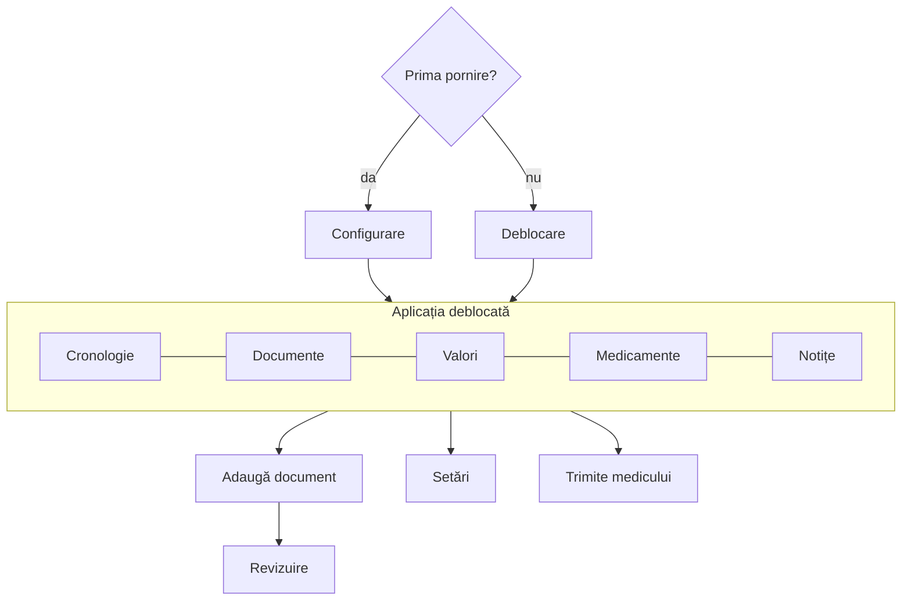

# 08. Ecranele și fluxurile

Documentul descrie **ce** face fiecare ecran și ce reguli respectă. Aspectul vizual (culori, iconuri, așezare exactă) se stabilește separat, la designul interfeței.

Persona folosită în exemple: **Maria**, 52 de ani, are diabet de tip 2, face analize la 3 luni și ține evidența tratamentului.

## 1. Harta aplicației

Navigare: bară de jos cu 5 secțiuni; buton principal „+” (adaugă document / notiță / medicament); setările din colțul de sus.

## 2. Configurarea (prima pornire)

| # | Ecran | Conținut | Cerință |
|---|---|---|---|
| 1 | Bun venit | Limba (EN / RO); ce face aplicația, într-o frază; „Încep de la zero” / „Am deja un export” | ADR-0009, DAT-22 |
| 2 | Vârsta | „Confirm că am cel puțin 18 ani.” Fără confirmare, aplicația nu continuă | ARH-12, LEG-12 |
| 3 | Scopul aplicației | Textul scopului declarat (ADR-0005): informează și organizează, nu pune diagnostice | ADR-0005 |
| 4 | Nota de informare | Textul complet (EN / RO), cu legătură spre versiunea întreagă | LEG |
| 5 | Consimțământul | Acord **explicit, separat** pentru prelucrarea datelor de sănătate pe telefon. Fără bifă precompletată. Se salvează `Consent` | LEG-04 |
| 6 | Blocarea telefonului | Verificare; dacă lipsește: explicație și buton către setările telefonului | SEC-34 |
| 7 | Parola | Alegerea parolei (doc. 04 §3.1), cu explicația: „Fără parolă și fără cuvintele de recuperare, datele nu pot fi recuperate de nimeni” | SEC-30, SEC-31, SEC-36 |
| 8 | Cuvintele de recuperare | Cele 24 de cuvinte + verificarea a 3 dintre ele | SEC-35 |
| 9 | Biometria | Opțional: „Deblochează cu amprenta / fața” | SEC-32 |
| 10 | Avertismentul de root | Doar dacă e cazul, o singură dată | SEC-70 |
| 11 | Exportul automat | Opțional: „Vrei ca aplicația să facă singură exporturi?” → configurare sau „Mai târziu” | DAT-24 |
| 12 | Profilul | Opțional: nume, anul nașterii, sexul (explicând la ce folosesc) | MODEL_DATE_FHIR §2 |

Pe varianta „Am deja un export”: ecranele 2–6, apoi importul (doc. 07 §2), apoi parola nouă și biometria.

## 3. Deblocarea

- Câmp de parolă + butonul biometric (dacă e activ și politica permite, doc. 04 §6).
- După încercări greșite: mesajul cu timpul de așteptare (doc. 04 §3.6).
- Legătura „Am uitat parola” → cele 24 de cuvinte → parolă nouă (doc. 04 §5.3).
- Fără date afișate înainte de deblocare (nici numărul de documente, nici numele).

## 4. Secțiunile principale

### 4.1 Cronologie

Lista evenimentelor în ordine inversă: buletine, documente, notițe, începutul și sfârșitul tratamentelor. Sus: **ciornele în așteptare** („2 documente așteaptă verificarea”).

### 4.2 Documente

Lista documentelor (filtrare după clasă: analize, rețete, notițe, altele), căutare în text (FTS, doc. 02 §4.5). Detaliul unui document: originalul (cu zoom, pagină cu pagină), valorile sau medicamentele extrase din el, acțiunile „Reprocesează”, „Șterge”.

### 4.3 Valori

- Lista testelor (grupate după `name_key`), cu ultima valoare și data.
- Detaliul unui test: graficul evoluției + tabelul valorilor.
- **Graficul** (ADR-0005): punctele valorilor; intervalul de referință **din buletin** ca bandă; **fără culori sau marcaje calculate de aplicație** („mare”, „mic”, roșu/verde). Marcajul H/L apare doar dacă e în document, ca text lângă valoare.
- Unități diferite: conversia doar pentru grafic, cu mențiunea „Unele valori au fost convertite din mg/dL pentru grafic” (ING-087); tabelul arată valorile originale.
- Atingerea unei valori: detaliul, cu sursa („din buletinul Synevo din 12.10.2026, verificat de tine”) și imaginea regiunii din document.
- „Adaugă manual o valoare”.

### 4.4 Medicamente

Active / Istoric; tratamentele ca grupuri; detaliul unui medicament cu schema și mementourile. Operațiile din doc. 06 §3.

### 4.5 Notițe

Listă și editor de text simplu. Notițele din documente scrise de mână au și imaginea.

## 5. Adăugarea unui document

1. „+” → „Fotografiază” / „Din galerie” / „Fișier PDF”.
2. Camera: ghidaj de încadrare; avertismentele de calitate (ING-011); „Adaugă pagina următoare” / „Gata”.
3. Ecranul paginilor: reordonare, decupare, ștergere.
4. Procesare (progres pe etape: „Citesc textul…”, „Caut valorile…”). Pacientul poate ieși; procesarea continuă cât aplicația e deblocată.
5. Clasa propusă: „Acesta pare un buletin de analize” → „Da” / „Schimbă”.
6. Revizuirea (doc. 05 §4).

## 6. Setările

| Grup | Elemente |
|---|---|
| Securitate | Schimbă parola; biometria; blocare după inactivitate (≤ 5 min) și în fundal (≤ 1 min); capturile de ecran (cu avertisment); ștergerea după încercări greșite (dezactivată implicit, cu avertisment); tipul de keystore al telefonului; starea root |
| Date | Export manual; export automat; restaurare din export; **„Ce date am”** (numărul de documente, valori, medicamente, notițe; spațiul ocupat; ce iese de pe telefon: nimic automat, doar exporturile și PDF-urile alese de pacient) (SEC-82) |
| Mementouri | Permisiunea de notificări și de alarme exacte; ajutorul pentru baterie |
| Limba | Sistem / English / Română |
| Profil | Nume, anul nașterii, sexul |
| Confidențialitate | Nota de informare; acordurile date (cu data); **retragerea consimțământului** (§7) |
| Despre | Scopul declarat; versiunea; operatorul de date **[Necesită răspuns: ORG-2]**; contactul de suport (email); licențele bibliotecilor; politica de raportare a vulnerabilităților (SEC-90) |
| Ștergere | „Șterge toate datele” (doc. 04 §9) |

## 7. Retragerea consimțământului (LEG-04)

Fără consimțământ, aplicația nu are voie să prelucreze datele de sănătate. Fluxul: explicație → „Vrei să faci întâi un export?” → retragere → `Consent.status = inactive` → **ștergerea totală** a datelor de pe telefon. (Formularea exactă se validează de jurist.)

## 8. Texte importante (EN / RO)

| Unde | EN | RO |
|---|---|---|
| Revizuire | Check the values against the document. The app can misread, especially handwriting. | Verifică valorile cu documentul. Aplicația poate citi greșit, mai ales scrisul de mână. |
| Scris de mână indisponibil | Handwriting could not be read. You can enter it manually. | Scrisul de mână nu a putut fi citit. Poți introduce manual. |
| Nume diferit | This document seems to be in another person's name. | Documentul pare să fie pe numele altei persoane. |
| Duplicat | This looks like the report from {date}. | Pare același buletin ca cel din {date}. |
| PDF | The file will leave the app and will no longer be protected by it. | Fișierul va ieși din aplicație și nu mai este protejat de ea. |
| Notificare | You have a reminder | Ai un memento |
| Fără date recuperabile | Without your password and your recovery words, nobody can recover your data, not even us. | Fără parolă și fără cuvintele de recuperare, datele nu pot fi recuperate de nimeni, nici de noi. |

Textele juridice (nota de informare, consimțământul, scopul declarat) se primesc de la jurist și **nu se modifică** în cod.

## 9. Accesibilitate

- Mărimea textului urmează setarea telefonului; ecranele funcționează la 200%.
- Toate elementele au descrieri pentru TalkBack.
- Stările (verifică, invalid, scris de mână) au text sau icon, nu doar culoare.
- Zonele de atingere de cel puțin 48 × 48 dp.
